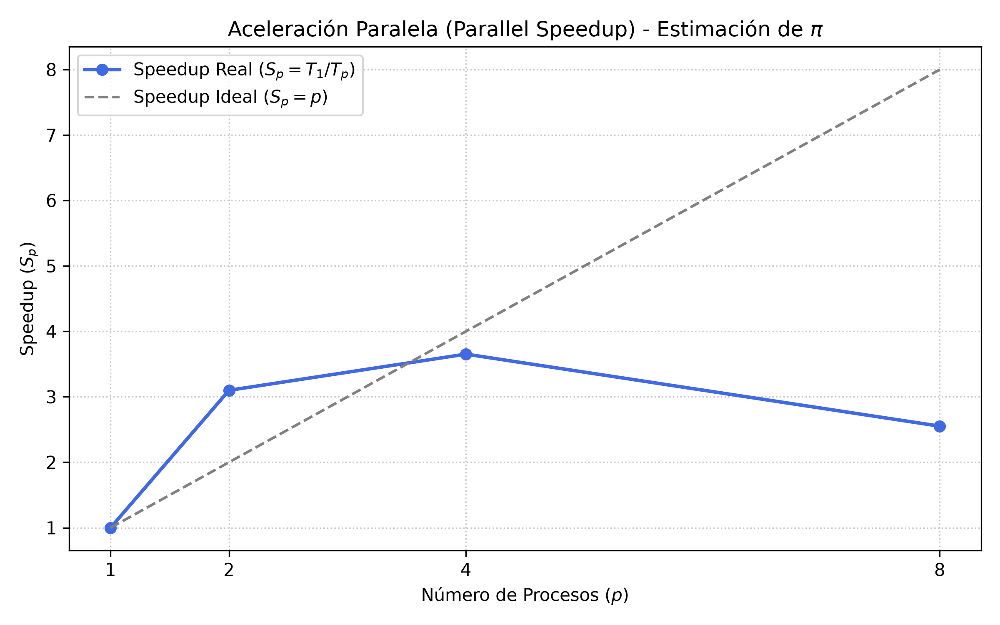
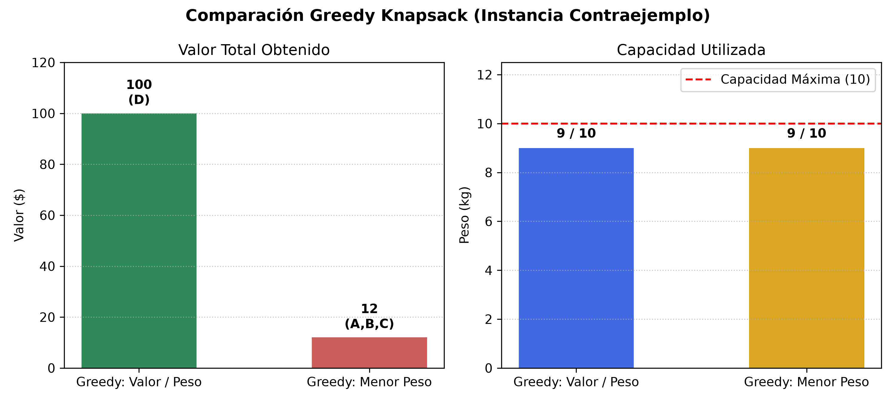
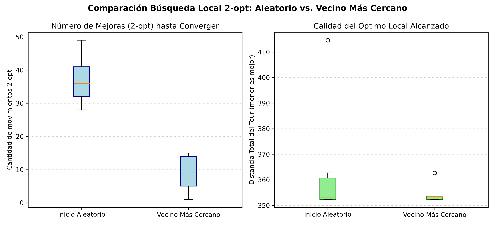
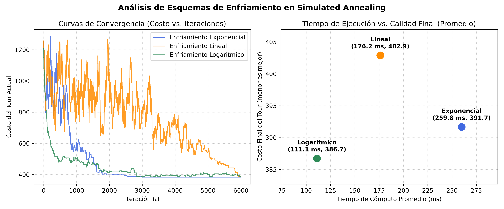
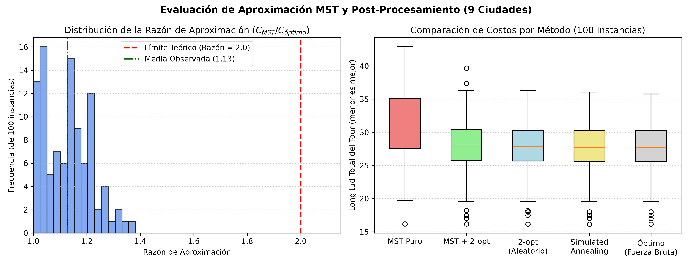

# Tarea 2 — Optimización de Algoritmos

Colección de cinco ejercicios prácticos de optimización y análisis de algoritmos, implementados en Python. Cada script genera sus resultados por consola y una gráfica en alta resolución (300 dpi) dentro de `graficas/`.

## Contenido

| # | Ejercicio | Técnica / Tema | Script |
|---|-----------|----------------|--------|
| 1 | Aceleración paralela | Monte Carlo para estimar π con `multiprocessing` y cálculo de *speedup* | [`src/ejercicio1_speedup.py`](src/ejercicio1_speedup.py) |
| 2 | Mochila fraccional vs. 0/1 | Greedy por densidad valor/peso vs. greedy por menor peso (contraejemplo) | [`src/ejercicio2_knapsack.py`](src/ejercicio2_knapsack.py) |
| 3 | TSP con 2-opt | Búsqueda local *first-improvement* desde inicio aleatorio y desde vecino más cercano | [`src/ejercicio3_2opt.py`](src/ejercicio3_2opt.py) |
| 4 | Recocido Simulado | Comparación de esquemas de enfriamiento: exponencial, lineal y logarítmico | [`src/ejercicio4_sa.py`](src/ejercicio4_sa.py) |
| 5 | Aproximación con MST | Prim + preorden, MST + 2-opt, 2-opt aleatorio y SA frente al óptimo por fuerza bruta | [`src/ejercicio5_mst.py`](src/ejercicio5_mst.py) |

## Resultados destacados

- **Ejercicio 1:** *speedup* de 3.65× con 4 procesos (eficiencia ≈ 91 %). Con 8 procesos el *overhead* reduce la ganancia a 2.55×.
- **Ejercicio 2:** la heurística valor/peso obtiene un valor de 100 (objeto D), mientras que menor peso primero solo alcanza 12 (A, B, C).
- **Ejercicio 3:** partir de un tour de vecino más cercano requiere 9.35 mejoras 2-opt en promedio, frente a 36.40 desde un tour aleatorio, y logra un costo ligeramente menor (353.46 vs. 356.40).
- **Ejercicio 4:** el enfriamiento logarítmico obtiene el mejor costo promedio (386.75) y el menor tiempo (111.07 ms); el lineal es el más costoso en calidad (402.90).
- **Ejercicio 5:** la razón de aproximación media del MST es 1.129 (máximo 1.383, muy por debajo del límite teórico 2.0). MST + 2-opt baja el costo de 31.168 a 27.894, y SA alcanza 27.637 frente al óptimo 27.617.

> Los valores pueden variar ligeramente entre ejecuciones por la naturaleza estocástica de los algoritmos y las condiciones de la máquina.

## Requisitos

- Python 3.10 o superior
- `matplotlib >= 3.9` (el ejercicio 3 usa el parámetro `tick_labels`)

## Instalación

```bash
git clone https://github.com/ViiiiicC0/Tarea_2_AO.git
cd Tarea_2_AO
python -m venv .venv
# Windows
.venv\Scripts\activate
# Linux / macOS
source .venv/bin/activate

pip install -r requirements.txt
```

## Ejecución

Cada ejercicio es independiente y guarda su gráfica en `graficas/`:

```bash
python src/ejercicio1_speedup.py
python src/ejercicio2_knapsack.py
python src/ejercicio3_2opt.py
python src/ejercicio4_sa.py
python src/ejercicio5_mst.py
```

Si se ejecuta en un entorno sin pantalla (servidor, CI), usar un backend no interactivo:

```bash
# Windows PowerShell
$env:MPLBACKEND="Agg"
# Linux / macOS
MPLBACKEND=Agg python src/ejercicio1_speedup.py
```

> El ejercicio 5 evalúa 100 instancias con fuerza bruta (8! rutas por instancia), por lo que puede tardar varios minutos.

## Estructura del repositorio

```
Tarea_2_AO/
├── README.md
├── requirements.txt
├── .gitignore
├── src/
│   ├── ejercicio1_speedup.py
│   ├── ejercicio2_knapsack.py
│   ├── ejercicio3_2opt.py
│   ├── ejercicio4_sa.py
│   └── ejercicio5_mst.py
├── graficas/
│   ├── ejercicio1_speedup.png
│   ├── ejercicio2_knapsack.png
│   ├── ejercicio3_2opt.png
│   ├── ejercicio4_sa.png
│   └── ejercicio5_mst.png
└── reporte/
    └── Reporte_Final.pdf
```

## Gráficas

| Ejercicio | Gráfica |
|-----------|---------|
| 1. Speedup paralelo |  |
| 2. Knapsack greedy |  |
| 3. Búsqueda local 2-opt |  |
| 4. Recocido Simulado |  |
| 5. MST y post-procesamiento |  |

## Reporte

El análisis completo, la metodología y las conclusiones están en
[`reporte/Reporte_Final.pdf`](reporte/Reporte_Final.pdf).
